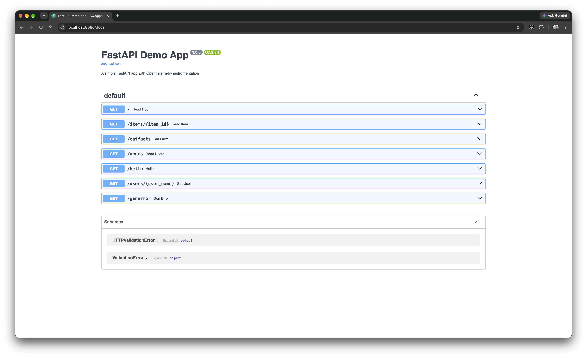
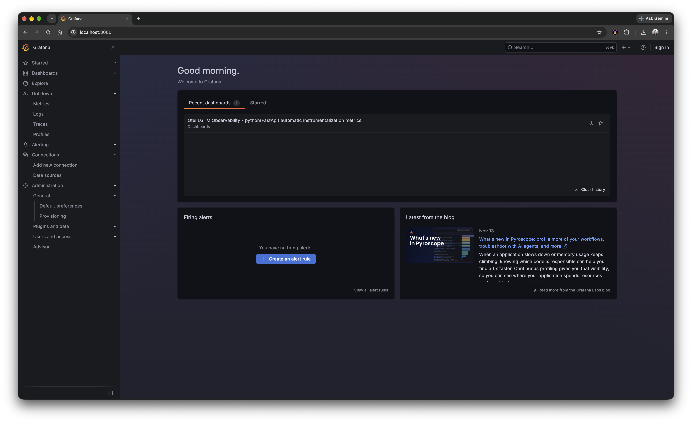

# python-otel-demo

Python based OpenTelemetry Collector demo stack for providing an understanding of telemetry

  [](https://hub.docker.com/r/grafana/grafana) [](https://hub.docker.com/layers/grafana/tempo/3.1.1/images/sha256-24ded48437b982348fdb52d6353d6e0a6ea519e57b0517d6065d419112d4032c)
[](https://hub.docker.com/layers/grafana/loki/3.7.9/images/sha256-569e5cab050b7705eb82080335ff9a8bd329650b358bb0d42131e3ced8d9492e)
 [](https://hub.docker.com/r/otel/opentelemetry-collector) [](https://hub.docker.com/_/postgres?tag=18.7) [](https://hub.docker.com/layers/prom/prometheus/v3.15.1/images/sha256-d445d1806b38f85b5c394a1b87f94113fde0473b45245922c2e8b1bd41fa68ae)

## Description

The goal of this repository is to provide an demo environment where a person can see how instrumented code translates into viewable telemetry signals. This is done with multiple small apps that are emitting logs, metrics, and traces to an OpenTelemetry Collector. The telemetry is then forward to a matching storage backend for each signal. Logs are sent to Loki, metrics are scraped from the collector and pulled into Prometheus, and traces are sent to Tempo.

## Quickstart Guide

### Requirements

You will need to install the following requirements first.

* [Docker](https://docs.docker.com/get-started/get-docker/)
* [Docker Compose](https://docs.docker.com/compose/install/)
* `git` CLI - install via homebrew

    ```bash
    brew install git
    ```

### Demo operations

* Clone this repository and cd into it:

    ```bash
    git clone https://github.com/justindesilets/python-otel-demo.git
    cd python-otel-demo
    ```

* Start the docker compose demo:

    ```bash
    make run
    ```

### Explore endpoints

* **[FastAPI](http://localhost:8080/docs):** This is the FastAPI Swagger Page where you can explore the API endpoints

    

* **[Grafana](http://localhost:3000/):** This instance starts up with preconfigured data sources for telemetry and a dashboard to help you visualize telemetry from the FastAPI app.

    
